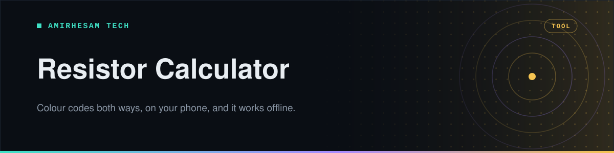

<p align="center">
  
</p>

<p align="center">
  <a href="https://resistor-calculator-lemon.vercel.app"></a>     <a href="https://github.com/amirh3sam/ResistorChart/stargazers"></a>
</p>

<p align="center">
  <a href="https://resistor-calculator-lemon.vercel.app"><b>Open the app</b></a> ·
  <a href="#what-it-does">What it does</a> ·
  <a href="#both-directions">Both directions</a> ·
  <a href="#more-tools">More tools</a> ·
  <a href="#development">Development</a> ·
  <a href="#faq">FAQ</a>
</p>

Four coloured stripes on a tiny cylinder, and the chart is always on the other side of the bench. Worse, resistors have no agreed orientation, so half the time you read the bands backwards and get 47Ω instead of 470kΩ.

This reads them in both directions, on the phone already in your hand, and keeps working once you install it — handy, since benches and lab cupboards are where signal goes to die. It also covers the other resistor sums that come up at the bench.

- **Tap a band to change it** on a live SVG resistor, rather than hunting through a dropdown.
- **Type a value instead** — `4700`, `4.7k`, `4k7`, `1M`, `0R22` all parse, and the bands follow.
- **4, 5 and 6-band** resistors, with tolerance, min/max range and temperature coefficient.
- **SMD codes** — `103`, `4R7`, `1002` and EIA-96 `01C`, read or written.
- **LED resistors** — supply, LED colour and current in; the right resistor and wattage out.
- **Series and parallel** — combine up to ten resistors, or find two standard ones that make the value you need.
- **Installs to your home screen**, runs with no connection, and reopens where you left off.

**[Open the calculator →](https://resistor-calculator-lemon.vercel.app)**

## What it does

| | |
|---|---|
Four tabs, one per job.

| Tab | |
|---|---|
| **Colour Bands** | Colours → value with tolerance, min/max range and temperature coefficient, or value → colours. E12/E24 lookup and the full colour chart |
| **SMD Code** | Decode or generate 3-digit, 4-digit, `R`-notation and EIA-96 markings, with a guide to each format |
| **LED Resistor** | The resistor for one LED or a string of them, its power rating, and a live circuit diagram |
| **Series / Parallel** | Total resistance of up to ten resistors, per-resistor voltage, current and power, and a two-resistor combination finder |

Dark and light themes, because bench lighting is never what you want. The current reading stays pinned to a sticky header while you scroll, and the app remembers your tab and every value between visits.

## Both directions

Most calculators only go one way. The reverse is the one you need more often: you know you want 4.7kΩ and you are digging through a drawer trying to find it.

```
4700   →  yellow  violet  red     gold
4.7k   →  yellow  violet  red     gold
4k7    →  yellow  violet  red     gold
0R22   →  red     red     silver  gold
1M     →  brown   black   green   gold
```

All five of those parse to the same place. The `4k7` and `0R22` forms are how values are printed on schematics and in catalogues, where a decimal point is easily lost in a photocopy.

> [!TIP]
> If a value is not a standard one, the app offers the nearest E12 or E24 part. Useful when the calculation says 3.3kΩ and the drawer disagrees.

## More tools

### SMD codes

Surface-mount resistors are too small for bands, so they carry a short printed code. The **SMD Code** tab reads all the common ones, and goes the other way too.

```
103    →  10 × 10³        =  10 kΩ     3-digit, usually ±5%
1002   →  100 × 10²       =  10 kΩ     4-digit, usually ±1%
4R7    →  R is the point  =  4.7 Ω
01C    →  100 × 100       =  10 kΩ     EIA-96, tiny ±1% parts
000    →  zero-ohm jumper
```

### LED resistors

Give it the supply voltage, the LED colour (which fills in a typical forward voltage) and the current you want. It works out **R = (V<sub>supply</sub> − n × V<sub>f</sub>) ÷ I**, rounds **up** to the next standard value so the LED never gets more current than you asked for, and picks a power rating with 2× headroom.

```
5 V,  1 red LED,    20 mA  →  150 Ω,  ⅛ W
12 V, 3 blue LEDs,  20 mA  →  120 Ω,  ⅛ W
```

It tells you when the supply is too low for the LEDs, and when there is so little voltage left over that brightness will wander.

### Series and parallel

Type up to ten values and pick series or parallel. You get the total, the formula written out, a diagram, and — if you enter a voltage — what each resistor sees.

The part you will use most is the finder underneath. Ask for a value you do not have and it searches every pair of E12 or E24 parts for the closest match:

```
3 kΩ    →  1.2 kΩ + 1.8 kΩ  (exact)
2.5 kΩ  →  1 kΩ + 1.5 kΩ    (exact)
1234 Ω  →  33 Ω + 1.2 kΩ    (−0.08%)
```

## Development

Next.js App Router, React and Tailwind.

```bash
npm install
npm run dev      # http://localhost:3000
npm run lint
npm run build
```

The calculations live in `lib/`, with no React in them, so they are easy to read and easy to test on their own:

| File | |
|---|---|
| [`lib/resistor.ts`](lib/resistor.ts) | Colour bands — `calculateFromColors`, `getColorsFromValue`, `parseResistance` |
| [`lib/smd.ts`](lib/smd.ts) | SMD codes — `decodeSmdCode`, `getSmdCodes` |
| [`lib/led.ts`](lib/led.ts) | LED resistors — `calculateLed` |
| [`lib/network.ts`](lib/network.ts) | Series and parallel — `combine`, `analyze`, `findCombinations` |

```
app/
├── page.tsx           tabs, colour-band calculator
├── resistor-svg.tsx   the tappable resistor
├── smd-panel.tsx      SMD codes tab
├── led-panel.tsx      LED resistor tab
├── network-panel.tsx  series / parallel tab
├── saved-state.ts     reopens where you left off
├── theme-toggle.tsx   light / dark switch
├── ui.tsx             shared controls
├── service-worker.tsx offline support
└── manifest.ts        home-screen install
```

Deploy with `npx vercel --prod`.

## FAQ

<details>
<summary><b>Which end do I read from?</b></summary>

The tolerance band is usually the odd one out — gold or silver, and set slightly apart from the rest. Put that on the **right**. If there is no gold or silver band, the wider gap goes on the right.

When it is genuinely ambiguous, enter it both ways: one reading will be a standard value and the other almost certainly will not.

</details>

<details>
<summary><b>Does it work without a connection?</b></summary>

Yes. A service worker caches the app on first visit, so after that it loads with no network. That is the point — the places you identify resistors in rarely have good signal.

</details>

<details>
<summary><b>Can I install it like an app?</b></summary>

Yes. On iPhone, Share → Add to Home Screen. On Android, Chrome offers "Install app". It then opens full screen with no browser chrome.

</details>

<details>
<summary><b>Does it remember my values?</b></summary>

Yes. The tab you were on and everything you typed or picked are saved on your phone as you go, so closing the app and coming back puts you exactly where you were. Nothing leaves the device — there is no account and no server.

</details>

<details>
<summary><b>What do the 5th and 6th bands mean?</b></summary>

A 5-band resistor adds a third significant digit, for precision parts. The 6th band is the temperature coefficient in ppm/°C — how much the value drifts as it heats up. It only matters in precision analogue work; for most things you can ignore it.

</details>

<details>
<summary><b>My resistor measures differently from the bands</b></summary>

Check the tolerance band first — a ±5% 4.7kΩ part is in spec anywhere from 4.465k to 4.935k. Beyond that, measure it out of circuit; parallel paths on the board will read low every time.

</details>

## About

Made by **[AmirHesam Tech](https://amirhesamtech.com)**. More tech content on TikTok: [@techwithamirh3sam](https://www.tiktok.com/@techwithamirh3sam).

If this saved you a trip to the chart, please give it a star. It helps other people find it.
